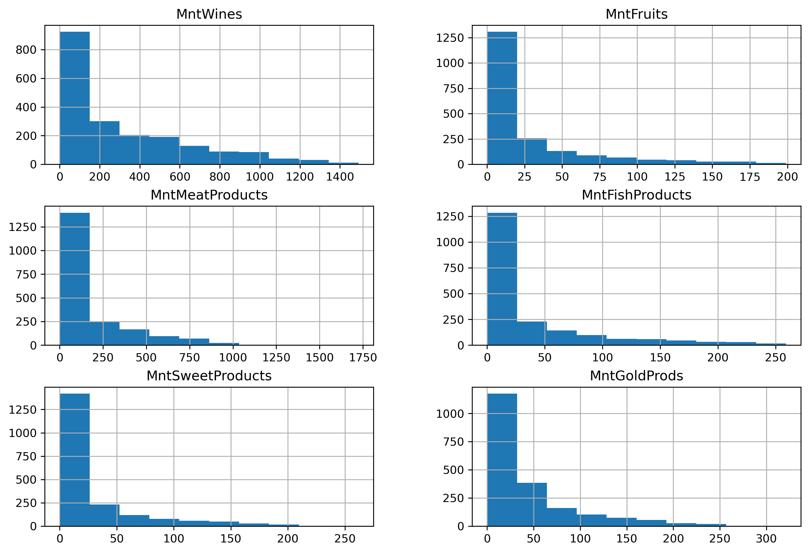
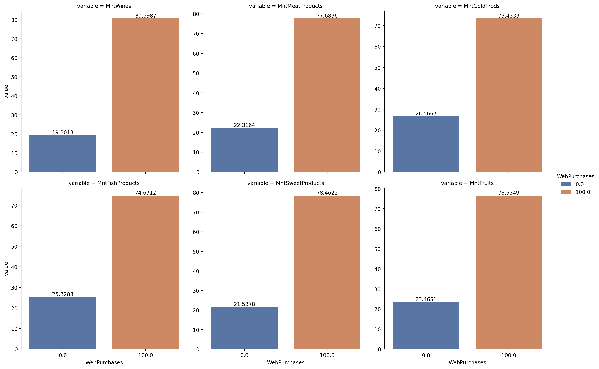
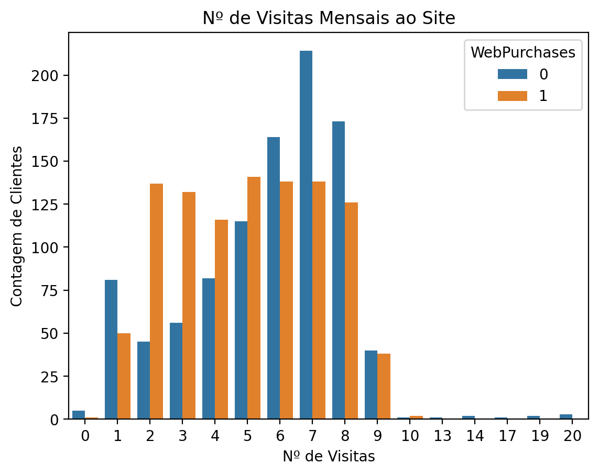
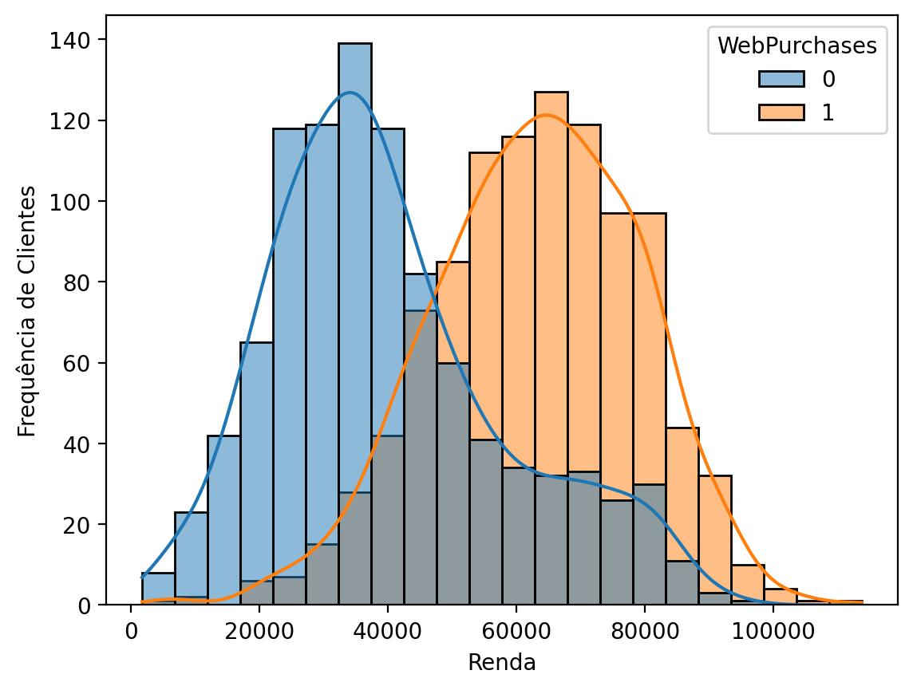
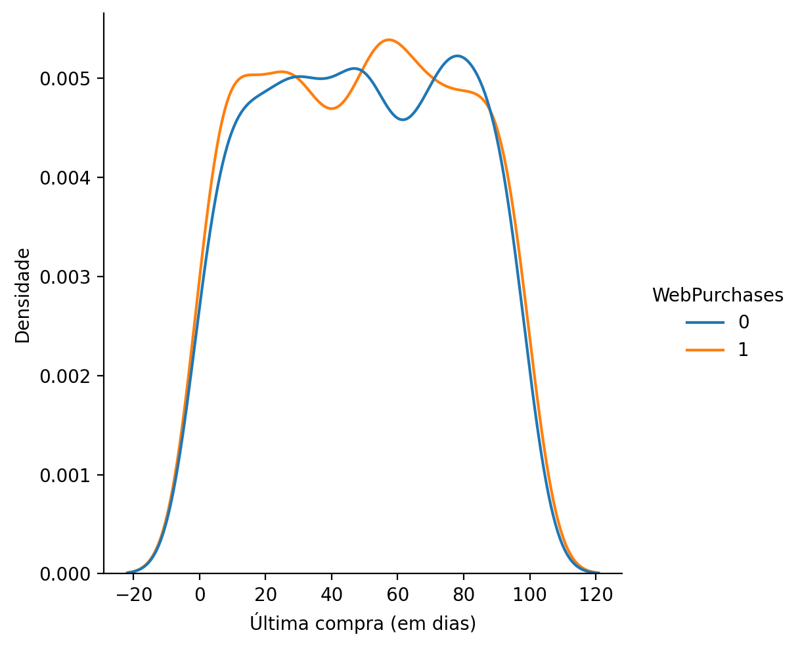
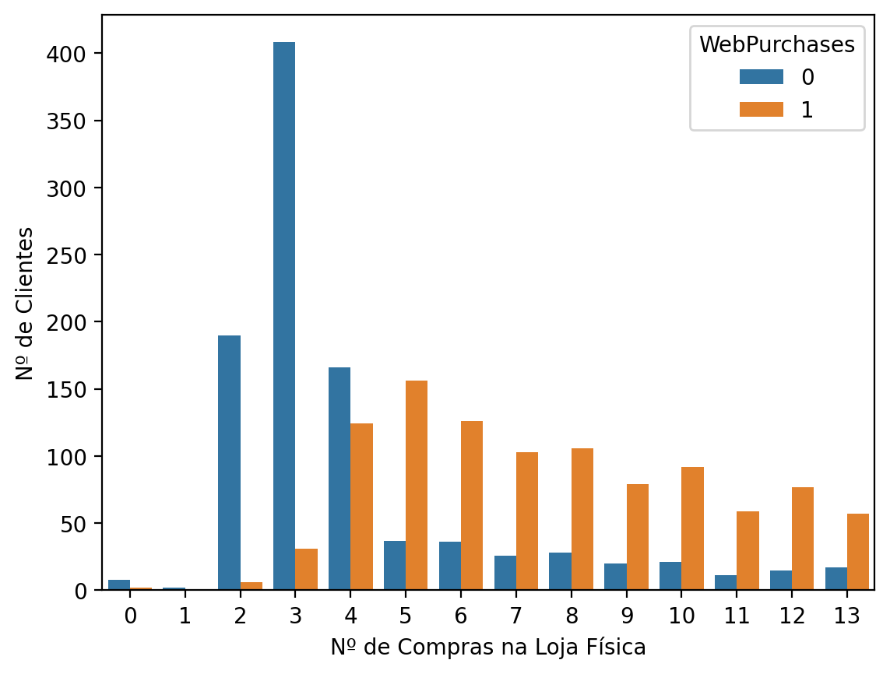

# E-commerce Purchase Intention Prediction  

*[Veja a versão em Português aqui](README.md)*

## Project Description
This project aims to create a predictive system to anticipate customer purchase intentions in e-commerce, based on demographic profiles and consumption history. The solution seeks to optimize marketing strategies, identify high-conversion profiles, and improve the user experience.

## Methodology (Data Pipeline)
Development followed standard Data Science stages:

**Preparation and Exploration (EDA)**: Analysis of data distribution and identification of correlations.

**Preprocessing**: Handling missing values, data cleaning, and feature engineering.

**Modeling**: Application of classification algorithms to predict purchase intention.

**Evaluation**: Validation of model performance using metrics such as Precision, Recall, and Confusion Matrix.

## Key Insights from Exploratory Data Analysis (EDA)
**Purchasing Behavior**: Categories such as Wine and Meat show the highest financial volume and online conversion rates, suggesting that e-commerce is a strong channel for these niches.

**Customer Profile**: Customers with an annual income above 50,000 demonstrate a higher propensity for online purchases, whereas lower-income consumers (up to 40,000) convert less.

**Loyalty**: There is a positive correlation between the number of in-store purchases and the propensity for online purchasing. Frequent in-store customers are more likely to migrate to digital channels.

**Browsing Behavior**: A significant group was identified that visits the site frequently (up to 8 times/month) without making purchases, suggesting the platform is used for price research prior to making a buying decision.

## Predictive Modeling

Two classification algorithms were tested: **Logistic Regression and Random Forest**.

- Winning Model: Random Forest outperformed Logistic Regression, achieving 90% average accuracy via cross-validation.
- Key Features: The 5 variables that most influenced the predictions were:
Wine spending, Meat spending, Income, Number of in-store purchases, and Number of monthly website visits.

- Performance: The final model showed an excellent balance, with 95% recall for the positive class, demonstrating a high capacity to capture customers with genuine purchase intent.

## Conclusions and Recommendations

**Conversion**: Targeted marketing actions (exclusive website discounts) can convert lower-income customers or those who only browse prices.

**Loyalty**: Customers with a low history of in-store purchases should be targeted by engagement campaigns to increase their purchase frequency and accustom them to the online channel.

**Efficiency**: Simplifying the model by using only the 5 most important features maintained its robustness (89% accuracy), proving to be an efficient solution for implementation.

### Some Visualizations Generated During the Project:

#### Spending - Product Categories

#### Product Categories

#### Website Visits

#### Income Analysis

#### Recency

#### Number of Purchases

